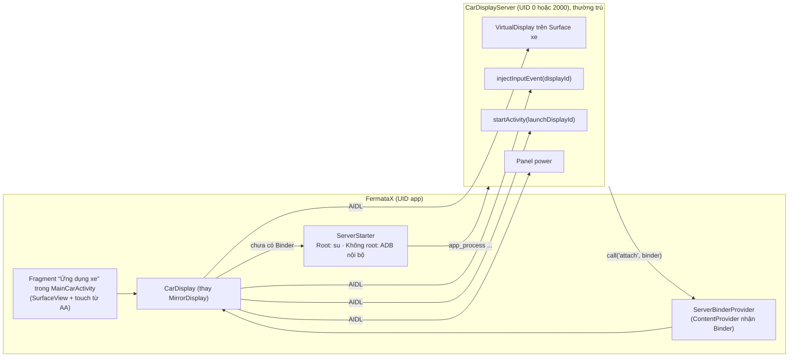

# Thiết kế: Màn hình xe độc lập (Virtual Car Display) cho FermataX — Root & Không Root

- Ngày: 2026-10-25 (bản 2)
- Đầu vào: `fermatax_virtual_display_launcher_report.md` (báo cáo giải mã CarStream), code hiện tại trong `fermata/src/auto`.
- Ưu tiên: **1. ổn định → 2. thao tác đơn giản → 3. hiệu năng**.
- Chuẩn so sánh: **trải nghiệm CarStream** — FermataX phải tương đương hoặc tốt hơn.
- Trạng thái: chờ duyệt. Chưa có code.

### Thay đổi so với bản 1 (theo yêu cầu của bạn)

- **Bỏ hoàn toàn chế độ phản chiếu** (MediaProjection, Accessibility, overlay độ sáng/xoay).
- **Chỉ một app**: không dùng Shizuku. Chế độ không root dùng **ADB không dây tích hợp trong FermataX** (giống CarStream), làm gọn hơn CarStream.

---

## 1. Kết luận ngắn

1. Một tiến trình đặc quyền duy nhất `CarDisplayServer`, khởi động bằng **một lệnh `app_process` duy nhất**, qua một trong hai đường:
   - **Root**: chạy lệnh qua `su` (dùng `Su.java` sẵn có). Không cần Developer Options, không cần Wi‑Fi.
   - **Không root**: FermataX tự ghép đôi Wireless Debugging một lần, rồi tự chạy lệnh qua ADB nội bộ (`localhost`).
2. Server **chạy thường trú tới khi khởi động lại máy**, không phụ thuộc phiên Android Auto và không phụ thuộc ADB còn bật. Lên xe là có ngay, không phải khởi động lại mỗi lần.
3. Server trao Binder cho app qua `ContentProvider.call` (cách CarStream v696 và Shizuku làm). Trạng thái sống/chết theo **Binder death**, không theo file heartbeat.
4. Không có quyền: màn hình xe hiện hướng dẫn cài đặt. Giao diện media của FermataX (`MainCarActivity`) vẫn chạy bình thường.

---

## 2. Đánh giá báo cáo: đúng / sai

| # | Khẳng định trong báo cáo | Thực tế (đã kiểm chứng) | Hệ quả cho thiết kế |
|---|---|---|---|
| 1 | FermataX hiện “nén/giải mã khung hình MediaProjection” | Sai. `MirrorDisplay.Session` vẽ thẳng vào Surface của AA. Chi phí thật: màn hình điện thoại phải sáng, render độ phân giải điện thoại rồi thu nhỏ + viền đen, hack xoay/độ sáng, input qua Accessibility. | Lợi ích đến từ **render đúng độ phân giải xe + tắt tấm nền**. |
| 2 | “Zero-copy, < 5 ms” tới xe | Quá lời: Android Auto vẫn tự encode Surface gửi sang head unit. | Đo trước/sau, không hứa con số. |
| 3 | `ShizukuEngine` không cần tiến trình riêng | `SurfaceControl`/`DisplayControl` là JNI tĩnh, chạy theo danh tính tiến trình gọi. | Bắt buộc có tiến trình UID shell/root → `CarDisplayServer`. |
| 4 | `Class.forName("com.android.server.display.DisplayControl")` | Không chạy: lớp nằm trong `services.jar`. scrcpy nạp bằng `ClassLoaderFactory.createClassLoader(SYSTEMSERVERCLASSPATH)` + `Runtime.loadLibrary0(cls, "android_servers")`. | Chép cách nạp của scrcpy. |
| 5 | “Bỏ cờ TRUSTED khi không root” | Ngược lại. Display không trusted chặn mọi Activity không khai `allowEmbedded` → Maps, Waze, YouTube không mở được. Shell có `ADD_TRUSTED_DISPLAY` + `ADD_ALWAYS_UNLOCKED_DISPLAY` ở Android 14 và 16. **Rủi ro**: nhánh `main` AOSP (sau 16) Shell không còn hai quyền này → Android 17 không root có thể hỏng. CarStream chịu cùng rủi ro. Root không bị ảnh hưởng. | Luôn xin TRUSTED (API 33+). Lỗi → báo rõ trên xe, gợi ý root (mục 9). |
| 6 | Cờ `0x8000 DEVICE_DISPLAY_GROUP` tách backstack/focus | Cờ này chỉ có tác dụng với VirtualDevice. Tách nhóm/focus là `OWN_DISPLAY_GROUP` + `OWN_FOCUS`. | Dùng bộ cờ scrcpy (4.3). |
| 7 | `PARTIAL_WAKE_LOCK` giữ máy khi tắt tấm nền | Không chặn thời gian chờ màn hình → máy tự khóa. | Xem 4.7. |
| 8 | Phantom Process Killer là do chạy daemon | Chỉ giết tiến trình **con của app**. Tiến trình sinh từ `adbd` (UID shell) hoặc daemon root không bị đếm. | Server luôn được sinh từ `adbd`/`su`, **không bao giờ** từ tiến trình app. |

Giữ lại từ báo cáo: `setLaunchDisplayId`, `InputEvent.setDisplayId` + `injectInputEvent(ASYNC)`, gửi `Surface` qua Binder, `setDisplayPowerMode`, bẫy Xiaomi.

Bổ sung: **server là bên khởi chạy Activity**. Shell/root có `INTERNAL_SYSTEM_WINDOW`, được `isCallerAllowedToLaunchOnDisplay` cho qua ngay bước đầu.

---

## 3. So với CarStream: tương đương và tốt hơn ở đâu

| Trải nghiệm | CarStream | FermataX (thiết kế này) |
|---|---|---|
| Hình lên xe | Direct projection (v696) | Tương đương: VirtualDisplay trên Surface AA |
| Điện thoại độc lập / tắt tấm nền, bấm nguồn 1 lần trả máy | Có | Tương đương (4.7) |
| Tách Back/focus khỏi điện thoại | Có (cờ sai, xem #6) | Tốt hơn: `OWN_DISPLAY_GROUP` + `OWN_FOCUS` đúng |
| Máy root | **Vẫn bắt ghép đôi ADB** | Tốt hơn: 1 lần bấm “Cho phép” trên Magisk/KernelSU, không cần Developer Options |
| Máy không root | Ghép đôi mã 6 số, thao tác qua lại Cài đặt | Tốt hơn: nhập mã ngay trên **thông báo** khi đang ở màn hình Cài đặt (không phải chuyển app); tự mở đúng trang Wireless debugging |
| Sau khi khởi động lại máy | Heartbeat file, `TuChayJob`, `BootReceiver` chắp vá | Tốt hơn: tự bật Wireless debugging bằng `WRITE_SECURE_SETTINGS` (cấp tự động lúc ghép đôi), tự khởi động server khi có Wi‑Fi, rồi tắt lại |
| Bị hệ thống giết | Có (daemon con của app) | Tốt hơn: server con của `adbd`/`su` |
| Phát hiện server chết | Heartbeat file | Tốt hơn: Binder death, tức thì |
| Bàn phím trên xe | — | `setDisplayImePolicy(LOCAL)`: Gboard hiện trên xe |
| Bảo trì | DRM, `libguard.so`, chuỗi mã hóa | Mã nguồn mở, không DRM |

---

## 4. Kiến trúc

### 4.1 Tổng thể



### 4.2 Khởi động server: một lệnh, hai đường

Lệnh duy nhất (đường dẫn APK lấy từ `ApplicationInfo.sourceDir` lúc chạy):

```
CLASSPATH=<apk> app_process /system/bin me.app.fermatax.server.Main <app-uid> <version-code>
```

- **Root**: `Su.get().exec("nohup <lệnh> >/dev/null 2>&1 &")`.
- **Không root**: ADB nội bộ mở `shell:` tới `127.0.0.1:<port>` và chạy cùng lệnh, tách khỏi phiên shell (`setsid`/`nohup`) để server sống tiếp khi ADB ngắt hoặc Wireless debugging tắt (cần xác nhận ở spike S5).
- `Main` kiểm tra không có server cũ đang chạy cùng `version-code` (nếu có bản cũ thì bản mới thay thế — xử lý khi app được cập nhật), rồi gọi `IContentProvider.call("attach", Bundle{binder})` tới provider của FermataX. Nếu app chưa chạy, provider khởi động app.
- App nhận Binder, `linkToDeath`. App chết rồi sống lại: server đăng ký `IProcessObserver` qua `IActivityManager` (cách `BinderSender` của Shizuku làm) và gửi lại Binder qua provider mỗi khi tiến trình FermataX khởi động. Provider chỉ nhận `call` từ UID shell/root.

Thư viện ADB: **libadb-android** (MuntashirAkon) — có `pair(host, port, code)` và `connect`. Chỉ có trên JitPack → thêm repo JitPack **có lọc** `includeGroup 'com.github.MuntashirAkon'`. README ghi chưa qua audit bảo mật → khóa ADB lưu trong Android Keystore/thư mục riêng của app, chỉ kết nối `127.0.0.1`. Phương án dự phòng: chép phần ADB của Shizuku manager (Apache-2.0).

### 4.3 `CarDisplayServer`

AIDL `ICarDisplayServer`:

| Hàm | Ý nghĩa |
|---|---|
| `int capabilities()` | Bitmask `VD`, `TRUSTED`, `INJECT`, `PANEL_POWER`, `IME`; server tự thử khi khởi động. |
| `int attach(in Surface s, int w, int h, int dpi, IBinder client)` | Tạo VirtualDisplay, trả `displayId`, launch launcher của FermataX lên đó. `client.linkToDeath` để tự dọn. |
| `void setSurface(in Surface s, int w, int h, int dpi)` | Đổi/resize Surface **không** hủy display; `s` null khi AA tạm ẩn. |
| `oneway void inject(in InputEvent e)` | Gán `displayId`, `injectInputEvent(ASYNC)`. |
| `void launch(in ComponentName c)` | Mở app lên display xe. |
| `void setPanelPower(boolean on)` | Tấm nền điện thoại. |
| `void release()` | Hủy display, bật lại tấm nền. Server **không thoát**, chờ phiên xe sau. |

- Ranh giới tin cậy: mọi hàm kiểm tra `Binder.getCallingUid() == app-uid`.
- Wrapper reflection (DisplayManager, InputManager, WindowManager, SurfaceControl, DisplayControl) theo cấu trúc `scrcpy/server/.../wrappers`; lỗi reflection → thiếu capability, không crash.
- Server nhẹ khi rảnh: không thread chạy nền, chỉ chờ Binder.

Cờ VirtualDisplay:
- Luôn: `PUBLIC | PRESENTATION | OWN_CONTENT_ONLY | SUPPORTS_TOUCH | DESTROY_CONTENT_ON_REMOVAL`
- API 33+: `| TRUSTED | OWN_DISPLAY_GROUP | ALWAYS_UNLOCKED | TOUCH_FEEDBACK_DISABLED`
- API 34+: `| OWN_FOCUS`
- Không dùng `ROTATES_WITH_CONTENT` (quyết định của tôi): xe cố định ngang; app khóa dọc sẽ được letterbox thay vì xoay cả màn hình.

IME: API 31+ `setDisplayImePolicy(displayId, LOCAL)`; API 29–30 `setShouldShowIme`.

### 4.4 Phía app: `CarDisplay`

- Thay `MirrorDisplay` với **cùng API công khai** (`get/release/setSurface/releaseSurface/tap/scale/motionEvent/close`) để fragment “Ứng dụng xe” và `CarSessionCoordinator` đổi ít nhất (xem 4.8 về vị trí trong giao diện chính).
- Chạm: host aauto cho MotionEvent thô, tọa độ Surface = tọa độ display → `inject(e)` thẳng, đa điểm tự nhiên. Host template (`MirrorServiceFS`, chỉ có ở bản `.test`) **không hỗ trợ** trong đợt này.
- Back = inject `KEYCODE_BACK`; Home = `launch(LauncherActivity)`.
- `LauncherActivity` chạy **trên display xe**; chạm app → `server.launch(component)`. Thêm hàng “Hay dùng / Gần đây” bằng `UsageStatsManager` để ngang CarStream (quyền `PACKAGE_USAGE_STATS` do server tự cấp: `appops set <pkg> GET_USAGE_STATS allow`).
- Server chưa sẵn sàng: vẽ thông báo lên Surface xe (`drawMsg` sẵn có), thử khởi động lại tối đa 3 lần (1 s, 2 s, 4 s). Hết lượt: hiện hướng dẫn trên xe.

### 4.5 Tự phục hồi sau khởi động lại máy (không root)

Nguyên tắc: **trên xe không cần Wi‑Fi và không cần ADB**. ADB chỉ dùng để *khởi động* server, mỗi lần khởi động máy một lần, thường là lúc ở nhà. Server sống tiếp suốt các chuyến đi. Server chết giữa chừng thì chạy lại qua chế độ TCP trong máy (bước 6), không cần Wi‑Fi. Chỉ trường hợp **khởi động lại máy khi đang ở ngoài và chưa gặp Wi‑Fi tin cậy nào** thì không tự phục hồi được.

1. Lúc ghép đôi lần đầu, qua ADB: `pm grant <pkg> android.permission.WRITE_SECURE_SETTINGS`.
2. `BOOT_COMPLETED` + `NetworkCallback` Wi‑Fi: khi có Wi‑Fi và server chưa chạy → `Settings.Global.putInt("adb_wifi_enabled", 1)` → tìm cổng bằng mDNS (`_adb-tls-connect._tcp`) → kết nối bằng khóa đã ghép → chạy lệnh server → tắt lại `adb_wifi_enabled` (trả trạng thái ban đầu).
3. Developer Options phải bật (Android yêu cầu); FermataX không tắt nó.
4. Không có Wi‑Fi từ lúc khởi động tới lúc lên xe: màn hình xe báo “Kết nối Wi‑Fi một lần (hoặc bật Hotspot) để khởi động dịch vụ”. Hotspot có thay được Wi‑Fi không → spike S6.

5. Wireless debugging chỉ tự bật **không cần hỏi** trên mạng Wi‑Fi đã được “Luôn cho phép”. Lúc ghép đôi, mạng nhà được tin cậy sẵn; mạng mới lần đầu sẽ hiện hộp thoại của hệ thống → FermataX chỉ thử tự động trên mạng đã tin cậy, mạng khác thì báo một thông báo trên điện thoại.
6. **Server chết khi nào** (spike S5): server sinh từ ADB nằm trong cgroup của `adbd`; mỗi lần `adbd` khởi động lại, `init` giết cả cgroup (`nohup`/`setsid` không thoát được). Tắt Wireless debugging và tắt Wi‑Fi **không** khởi động lại `adbd` → server sống. Các sự kiện làm `adbd` khởi động lại: tắt USB debugging, lệnh `tcpip`/`usb`, `adbd` crash. Root không bị ảnh hưởng.
7. **Chế độ TCP** (tùy chọn, **mặc định tắt** — chờ bạn quyết): FermataX gửi `tcpip:5555` *trước khi* khởi động server (vì chính lệnh này khởi động lại `adbd`). Sau đó, nếu `adbd` khởi động lại và giết server, FermataX kết nối lại `127.0.0.1:5555` và chạy lại server **không cần Wi‑Fi**, tới lần khởi động máy sau. Cái giá đã kiểm chứng: `adbd` nghe trên **mọi interface** (shell không đặt được `service.adb.listen_addrs`), vẫn đòi khóa RSA đã tin cậy; máy lạ trong cùng mạng có thể làm hiện hộp thoại “Cho phép gỡ lỗi USB?”.

Root: `BOOT_COMPLETED` chạy lệnh qua `su`, không cần mạng.

### 4.6 Ghép đôi lần đầu (không root) — mục tiêu ≤ 1 phút

1. Readiness → nút “Thiết lập màn hình xe”.
2. Nếu Developer Options chưa bật: màn hình hướng dẫn 1 trang (chạm Số hiệu bản dựng 7 lần) + nút mở trang Giới thiệu điện thoại.
3. FermataX đăng thông báo có ô nhập mã (`RemoteInput`) rồi mở thẳng trang Wireless debugging.
4. Người dùng bật Wireless debugging → “Ghép đôi bằng mã” → gõ 6 số vào **thông báo** (không rời Cài đặt). FermataX tự tìm cổng ghép đôi bằng mDNS (`_adb-tls-pairing._tcp`).
5. FermataX tự kết nối, cấp `WRITE_SECURE_SETTINGS`, khởi động server, báo “Xong”.
6. Xiaomi/HyperOS: nếu `inject` bị từ chối → một dòng hướng dẫn bật “USB debugging (Security settings)”.

Máy root: Readiness → “Cấp quyền root” → popup Magisk/KernelSU → xong.

### 4.7 Màn hình điện thoại

- ~~Phương án A~~ (khóa máy bình thường): **loại** theo spike S1 — khóa máy thì display ảo chuyển `state OFF`, app ngừng vẽ và không nhận chạm, dù có `OWN_DISPLAY_GROUP + ALWAYS_UNLOCKED`.
- **Phương án B** (ngang CarStream “Nền tắt”, đã chạy được ở spike): server `setDisplayPowerMode(OFF)` cho mọi display vật lý (cách scrcpy; Android 14+ qua `DisplayControl` nạp từ `services.jar`). Server giữ máy thức bằng `SCREEN_DIM_WAKE_LOCK` lấy ngay trong tiến trình server (UID shell lấy được). Không dùng overlay. Bấm nguồn một lần: app nghe `ACTION_SCREEN_OFF` → server bật lại tấm nền + `wakeUp`, nhả wake lock, “nhường máy” (cơ chế này chưa thử ở spike).
- Bất biến an toàn: tấm nền **luôn** bật lại khi AA ngắt, `release()`, app chết (`linkToDeath`), exception trong server. Xấu nhất (server bị kill cứng khi tấm nền tắt): bấm nguồn hai lần.
- Tùy chọn “Tắt màn hình điện thoại khi lên xe”, mặc định bật nếu có `PANEL_POWER`.

### 4.8 Giao diện màn hình xe

**Nguyên tắc (quyết định ngày 2026-10-29): rail Glass gốc của FermataX giữ nguyên, tính năng này chỉ là một chức năng thêm vào.** Không sửa `GlassNavigationRailView` (5 nút Home, Voice, Apps, Settings, Exit; grabber ở mép, kéo dọc, mờ dần, nổi lên trên nội dung, vị trí trái/phải theo `getNavBarPosPref`).

**Thực trạng đã đọc trong mã:** rail sống trong giao diện chính (`MainCarActivity` → `CarService`). Chế độ phản chiếu hiện tại là một mục Android Auto **riêng** (`MirrorService`, mặc định `enabled=false`) có thanh Home/Back nổi riêng, nên chưa từng chung màn hình với rail. `MirrorServiceFS` (host template) chỉ có trong bản `.test`.

**Vị trí tính năng — trong giao diện chính, không phải mục AA thứ hai**
- Thêm một màn hình “Ứng dụng xe” (fragment trong `MainCarActivity`) chứa `SurfaceView` hiển thị display ảo, theo đúng cách `MirrorActivity` đang làm với `SurfaceView`. Mở từ thẻ trên Dashboard và từ một **phím tắt Quick Bar** (cơ chế `GlassQuickShortcut` đã có, thêm một loại), không thêm nút vào rail.
- Bỏ `MirrorService`/`MirrorActivity`/`MirrorServiceFS` cùng chế độ phản chiếu; chỉ còn **một** mục Android Auto như hiện nay. (Cần xác minh khi lập kế hoạch: fragment có nhận được `SurfaceView` đủ tốt trong `MainCarActivity`, và `CarSessionCoordinator` vẫn teardown đúng.)

**Tránh chồng chéo với rail — các quy tắc** (bản chốt 2026-10-29: thanh điều hướng nằm **ngang ở đáy**, không dùng thanh dọc)
1. **Khác trục:** rail là thanh dọc ở mép trái/phải; thanh của tính năng này là thanh **ngang ở đáy**, kiểu ba nút điều hướng Android. Hai thanh không chung trục nên không thể nhầm là một rail thứ hai.
2. **Không chiếm chỗ của rail:** thanh đáy chiếm chiều cao của display ảo (khoảng 13% ở 16:9, ước lượng từ mockup, chưa đo trên DHU), không chiếm chiều rộng. Rail vẫn nổi lên trên cả hai. Grabber ở khoảng giữa mép nên cách xa thanh đáy.
3. **Không dùng lại nút của rail:** rail Home = về Dashboard Fermata (phiên ảo và app giữ nguyên, quay lại bằng Quick Bar); rail Exit = thoát FermataX như cũ và `CarSessionCoordinator` đóng phiên ảo.
4. **Thứ tự lớp:** rail (elevation/translationZ 24dp) luôn nằm trên; khi rail mở, scrim phủ cả display ảo lẫn thanh đáy. Cử chỉ vuốt từ mép của rail (36dp) do rail xử lý trước.
5. **Back của hệ thống/Android Auto:** `onBackPressed` hiện có đi qua rail trước; sau đó, nếu đang ở màn hình “Ứng dụng xe”, chuyển thành Back vào app; đang ở drawer thì về Dashboard.
6. **Fullscreen:** khi rail ẩn theo `setBarsHidden`, thanh đáy ẩn cùng lúc và display ảo lấy toàn bộ chiều cao.
7. **Mép rail:** grabber (đã mờ dần sau vài giây trên xe) vẫn đè nhẹ lên mép app phía rail, giống mọi màn hình Fermata khác. Rủi ro: app có nút sát mép đó. Kiểm tra bằng Maps, YouTube, Waze; nếu phiền thì chừa lề cho display ảo (chỉ làm khi có bằng chứng).

**Thanh điều hướng đáy — 3 nút**
| Nút | Việc làm | Cách thực hiện |
|---|---|---|
| Quay lại | Back trong app đang mở. Mờ khi đang ở drawer | server `inject(KEYCODE_BACK)` lên display |
| App drawer | Về launcher, app vẫn chạy nền (icon lưới chấm, khác icon lưới ô của nút Apps trên rail) | server đưa `LauncherActivity` lên trước (`CLEAR_TOP | SINGLE_TOP`) |
| Đóng app | Thoát app đang ở trên cùng rồi về drawer. Chạm: đóng task (`removeTask`, giữ dịch vụ nhạc). Chạm giữ: `force-stop`. Mờ khi đang ở drawer | server |

- Nút cao ≥ 76dp theo cỡ nút rail (tỉ lệ 1,9:1 trong mockup), nhãn truy cập, màu/bo góc/độ kính lấy từ `GlassThemeManager`/`GlassDimensions`. Vẽ bằng View trong fragment.
- Display ảo = vùng nội dung của fragment trừ thanh đáy, nên app không bị thanh che.
- Thanh không tự thu nhỏ hay mờ dần (YAGNI); nếu mất 13% chiều cao gây phiền thì thêm sau.

**App drawer (chạy trên display ảo)** — mockup đã gửi (rail bên phải hoặc trái, thanh đáy cố định):
- Đầu trang: tiêu đề “Ứng dụng”, đồng hồ, nút “Tắt màn hình điện thoại” (phương án B ở 4.7).
- Hàng “Gần đây”: 4 ô nhỏ, ưu tiên app đang chạy trên display (server liệt kê task), sau đó `UsageStatsManager`.
- “Tất cả ứng dụng”: lưới cột = rộng/96dp (3–8; 8 cột ở mockup), icon 56dp (tới 72dp khi rộng), dùng lại cơ chế chọn app/sắp xếp của `LauncherActivity`, có ô “Thêm”.
- Trạng thái: đang tải (khung xương), chưa chọn app (“Chạm + để thêm ứng dụng”), server chưa sẵn sàng/chưa thiết lập (một câu chữ lớn, không nút phải bấm khi lái), nút bị vô hiệu (mờ nhưng vẫn nhận chạm, có phản hồi).
- Theme Glass sẵn có, ngày/đêm theo Android Auto; chừa vùng an toàn theo `onStableAreaChanged`.
- Kiểm thử giao diện: ảnh chụp trên DHU 720p và 1080p, rail trái và phải, ngày và đêm, rail mở và đóng.

**Tham khảo CarStream** (mã giải mã v563/v696; app trên máy cần key nên chưa thấy giao diện xe thật): launcher thích ứng theo tỉ lệ display, icon 56–72dp, cột = rộng/96dp (3–8), nhãn 12sp, thẻ bo góc 22–28dp, ngày/đêm; Back là `input -d <display> keyevent 4`. FermataX không chép trang chủ nhiều ô của CarStream.

---

## 5. Gỡ bỏ phản chiếu

Xóa (kiểm tra caller trước khi xóa trong kế hoạch chi tiết):
- `MirrorDisplay` (thay bằng `CarDisplay`), `ProjectionService`, `ProjectionActivity`, `AccessibilityEventDispatcherService`, `XposedEventDispatcherService`, `EventDispatcher`.
- Phần `Xposed.java` chuyển tiếp sự kiện cho phản chiếu. **Giữ** các hook nguồn cài đặt Play Store (không liên quan).
- Manifest: `FOREGROUND_SERVICE_MEDIA_PROJECTION`, service accessibility, `ProjectionService`/`ProjectionActivity`; dòng Accessibility trong `ReadinessPrefsBuilder`; chuỗi tài nguyên không còn dùng.
- Cài đặt `isMirroringMode`/`isMirroringLandscape` và hack độ sáng/xoay.
- Test `MirrorShutdownPolicyTest`: chuyển sang `CarDisplay` hoặc xóa nếu chính sách không còn.

Hệ quả cần chấp nhận: **Android 9 (API 28) mất tính năng màn hình xe** (VirtualDisplay đa màn hình cần API 29). Android 10 không root cũng mất (Wireless debugging cần API 30). Các máy này vẫn có giao diện media.

---

## 6. Phạm vi

**Mục tiêu**
- Root (API 29+) và không root (API 30+), một app duy nhất.
- Mở mọi app có launcher lên xe, đa điểm, Back/Home, bàn phím trên xe.
- Điện thoại dùng độc lập hoặc tắt tấm nền, bấm nguồn một lần trả máy.
- Lên xe không phải thao tác gì nếu server đã chạy từ trước.

**Không làm**
- Shizuku, phản chiếu.
- Split screen, nhiều display, Recents, định tuyến âm thanh theo display.
- DRM/obfuscation.

**Thất bại dù “chạy được”**
- Điện thoại kẹt màn hình đen sau khi rời xe.
- Hộp thoại cấp quyền bật lên khi đang lái.
- Người dùng phải ghép đôi lại sau mỗi lần khởi động máy.

---

## 6b. Phân phối

- Tính năng chỉ nằm trong flavor **`auto`** (bản sideload, đã có `aauto.aar`, hook Xposed). Flavor **`mobile`** không đổi.
- Không tách app thứ ba: tách sẽ làm hai mục trong launcher Android Auto, hai lần cấp quyền, hai tiến trình tranh phiên xe — ngược với “chỉ một app”.
- Nếu sau này cần bản `auto` không có tính năng này: thêm một cờ build trong flavor `auto`, không tạo app riêng.

## 7. Phụ thuộc

- `com.github.MuntashirAkon:libadb-android` (JitPack, lọc theo group) — chỉ dùng cho không root.
- Không thêm libsu: root dùng `Su.java` sẵn có vì đường khởi động đã thống nhất bằng `app_process` + `ContentProvider`.

---

## 8. Kiểm thử và đo

**Unit test** (`src/testAuto`):
- Bộ cờ VirtualDisplay theo SDK.
- Chọn đường khởi động (root / ADB / chưa thiết lập) theo trạng thái.
- Chính sách thử lại và phục hồi sau boot (có Wi‑Fi / chưa có).
- Bất biến bật lại tấm nền cho từng sự kiện kết thúc.
- Kiểm tra UID gọi trong server.

**Thiết bị** (DHU qua `run_dhu.bat` + xe thật): Pixel (A14, A15, A16), Samsung One UI, Xiaomi HyperOS; mỗi máy × root/không root; kịch bản: lên xe, rời xe, khởi động lại máy, cập nhật app, kill app, bấm nguồn.

**Đo, so trực tiếp với CarStream trên cùng máy** (ghi vào diagnostics sẵn có):
- Thời gian từ cắm xe tới khung hình đầu.
- Độ trễ chạm (timestamp event → inject).
- Nhiệt độ pin và mức tụt pin sau 30 phút Maps.
- Số lần server chết, lý do; số lần phải ghép đôi lại.

---

## 9. Rủi ro

| Rủi ro | Mức | Xử lý |
|---|---|---|
| Android 17: Shell mất `ADD_TRUSTED_DISPLAY` | Cao (tương lai) | Theo dõi beta; root không ảnh hưởng; không root khi đó: server vẫn launch được app đầu tiên (`INTERNAL_SYSTEM_WINDOW`), kiểm tra mức hỏng thực tế ở S3. |
| Không có Wi‑Fi sau khởi động lại máy | Trung bình | Server thường trú; tự khởi động khi gặp Wi‑Fi; S6 kiểm tra Hotspot. |
| OEM chặn inject (Xiaomi) / chặn `setDisplayPowerMode` (Honor A14…) | Trung bình | Capability + hướng dẫn; Phương án A không cần tấm nền. |
| libadb-android chưa audit | Thấp–TB | Chỉ `127.0.0.1`, khóa riêng của app; có phương án chép từ Shizuku. |
| Mất tính năng trên Android 9–10 | Đã chấp nhận | Ghi CHANGELOG. |

---

## 10. Spike trước khi lập kế hoạch chi tiết

| Spike | Câu hỏi | Quyết định phụ thuộc |
|---|---|---|
| S1 | Khóa máy bình thường, app trên display `OWN_DISPLAY_GROUP + ALWAYS_UNLOCKED` có chạy tiếp và nhận chạm? | Phương án A hay B (4.7) |
| S2 | API 29–32 (không TRUSTED): Activity con trong app có bị chặn? | Hỗ trợ đầy đủ từ API nào |
| S3 | Android 16 thật, không root: xin TRUSTED thành công? | Mức khẩn của rủi ro Android 17 |
| S4 | Host template: `onScroll` → MOVE có mượt cho bản đồ? | Có ưu tiên host aauto |
| S5 | Server sinh từ ADB (`setsid`) sống tiếp khi tắt Wireless debugging và rời Wi‑Fi? | Cốt lõi của 4.5 |
| S6 | Wireless debugging bật được khi điện thoại phát Hotspot, không Wi‑Fi? | Hướng dẫn khi không có Wi‑Fi |
| S7 | Chế độ TCP (`tcpip`) trên Android 11–16: có chỉ nghe localhost được không, OEM nào chặn? | Bật chế độ TCP mặc định hay không |
| S8 | Android Auto không dây (điện thoại nối Wi‑Fi của đầu xe, không có Internet): Wireless debugging có bật được trên mạng đó? | Khởi động lại server ngay trên xe cho người dùng AA không dây |

### Kết quả spike (2026-10-29)

Máy thử: Redmi Note 8 (ginkgo), ROM tùy biến Android 16 (API 36, build BP4A), Magisk. Một máy, không phải ROM gốc Xiaomi → kết quả về OEM chưa đại diện.

| Spike | Kết quả | Bằng chứng |
|---|---|---|
| S3 | **Đạt.** UID shell tạo được display với `TRUSTED, OWN_DISPLAY_GROUP, ALWAYS_UNLOCKED, TOUCH_FEEDBACK_DISABLED, OWN_FOCUS` | `flags=0xf88`, owner `com.android.shell (uid 2000)` |
| — | Shell mở Google Maps lên display ảo bằng `am start --display`, Maps vẽ đúng bố cục ngang 1280×720; `input -d <id> swipe` hoạt động | Ảnh khung hình, bộ đếm frame tăng sau swipe |
| S1 | **Không đạt.** Khóa máy → display ảo `state OFF`, ngừng vẽ, chạm không có tác dụng; mở máy → chạy lại | `mWakefulness=Dozing`, frame đứng yên |
| B | **Đạt.** Tắt tấm nền qua `DisplayControl` (UID shell) → hệ thống vẫn `Awake`, display ảo vẫn vẽ và nhận chạm. Hết thời gian chờ màn hình thì máy ngủ, **trừ khi** server giữ `SCREEN_DIM_WAKE_LOCK` (lấy được từ UID shell) | Thời gian chờ 15 s; có wake lock vẫn `Awake` sau 40 s |
| S5 | **Đạt một phần.** Server sinh từ ADB sống khi tắt Wireless debugging và tắt Wi‑Fi; **chết** khi `adbd` khởi động lại. Server sinh từ `su` sống qua `adbd` khởi động lại | pid `adbd` không đổi khi tắt Wireless debugging; cgroup `/system/uid_0/pid_<adbd>` vs `/` |
| S6 | **Không đạt.** Không có Wi‑Fi, hoặc chỉ phát Hotspot → Android tự trả `adb_wifi_enabled` về 0 | Thử cả hai trường hợp |
| S7 | `tcpip` khởi động lại `adbd` và nghe trên mọi interface; shell không giới hạn được về localhost | `/proc/net/tcp6 :::5555`, `setprop service.adb.listen_addrs` bị từ chối |
| Nút nguồn trả máy | **Đạt** (máy root, bằng `input keyevent KEYCODE_POWER`, chưa phải nút vật lý). Tấm nền tắt + wake lock → `Awake`; nhấn nguồn → `Dozing` (có sự kiện tắt màn hình để app bắt); `setDisplayPowerMode(2)` + `KEYCODE_WAKEUP` → `Awake`, tấm nền `ON`, display ảo vẽ và nhận chạm lại. Máy thử không có khóa màn hình; máy có PIN sẽ hiện màn hình khóa lúc trả máy. | `mWakefulness`, bộ đếm frame |
| Launcher trên xe | **Đạt một phần.** `LauncherActivity` hiện có chạy được trên display ảo (3 app + nút thêm). Chạm Chrome trong đó → Chrome mở **trên display ảo**, không phải điện thoại (hệ thống mở theo display của Activity gọi) — code `startActivity` hiện có đã đủ cho trường hợp này, `server.launch` chỉ cần cho lần mở đầu và nút dock. Chưa có hàng “Gần đây”. | `dumpsys activity`: Chrome ở `Display #455` |
| Bàn phím trên xe | **Đạt, với điều kiện.** Mặc định bàn phím hiện **trên điện thoại** (`mCurTokenDisplayId=0`). Sau `IWindowManager.setDisplayImePolicy(id, LOCAL)` do root gọi, Gboard hiện trên display ảo và gõ chữ vào Chrome được. Bàn phím chiếm khoảng 45% chiều cao ở 720p. | Ảnh khung hình, `mCurTokenDisplayId=455` |
| Thanh điều hướng đáy + rail gốc | **Chưa thử được**: cần bản build có fragment “Ứng dụng xe” + DHU. | — |
| Chi phí server rảnh | Một `app_process` rảnh (chưa bật màn hình ảo) trên Redmi Note 8: CPU 0 tick trong 30 giây, không giữ wake lock, `oom_score_adj=-1000` (không bị LMK giết). RAM: **~85 MB private dirty (PSS ~125 MB)** dù chỉ có `Looper`. Phần lớn là ảnh khởi động ART phải tự chỉnh lại (`boot-framework.art` 14,5 MB, `boot-framework-adservices.art` 10,4 MB, `boot.art` 3 MB…). Các cờ `-Xnorelocate`, `-Xmx16m -Xms2m`, `-Xusejit:false` không giảm; `-Xnoimage-relocate`, `-Xint` không chạy. Khi Android nén trang rảnh vào zram (tỉ lệ 3,7:1 trên máy này), ép thử bằng `/proc/<pid>/reclaim` đưa PSS từ 126 MB xuống 2 MB, 85 MB sang zram ≈ 23 MB RAM thật. | `smaps_rollup`, `/proc/<pid>/stat`, `mm_stat` |
| S10: `persist.adb.tcp.port` bằng quyền shell | **Không đạt** trên máy thử: `setprop` bị SELinux từ chối (giá trị vẫn rỗng, máy không bị thay đổi). Không dùng được để `adbd` nghe TCP sau khởi động lại cho máy không root. Chưa thử ROM khác. | `Failed to set property` |
| S6b: mẹo hotspot của Shizuku-Next (ghi `adb_wifi_enabled` liên tục) | **Chưa kết luận.** Với hotspot bật, Wi‑Fi tắt: một lần ghi và 25 lần ghi cách ~100 ms (`settings put`) đều bị Android đặt lại về 0 ngay, không xuất hiện cổng TLS. Vòng ghi 2–20 ms như Shizuku-Next chưa chạy được từ công cụ thử (lỗi `SecurityException` do tên gói), nên phải thử trong app có `WRITE_SECURE_SETTINGS`. | `adb_wifi_enabled`, `service.adb.tls.port`, `/proc/net/tcp6` |
| S2, S4, S8 | Chưa thử: cần máy Android 10–12, DHU với bản build FermataX, và xe thật | — |

**Đối chiếu CarStream** (bản 1.24.93 trên máy cần key kích hoạt nên không chạy được; đọc mã nguồn v696 đã giải mã):
- Khởi động helper đúng như thiết kế này: tìm cổng Wireless debugging bằng mDNS → kết nối bằng khóa đã ghép → `shell:` chạy `csrun`. Helper cũng là tiến trình con của `adbd`, nên cũng **chết khi `adbd` khởi động lại** (shell không thoát được cgroup — đã thử, `Permission denied`).
- Tự chạy lại: `BootReceiver` + `TuChayJob`, dùng `WRITE_SECURE_SETTINGS` để tự bật `adb_enabled` và `adb_wifi_enabled`. Khi không có Wi‑Fi, nó chỉ báo người dùng bật Wi‑Fi hoặc gỡ lỗi không dây → **cùng giới hạn Wi‑Fi** như FermataX.
- “Giữ adb”: theo dõi `adb_enabled`, ai tắt USB debugging thì bật lại ngay. → Thêm vào thiết kế (giảm một nguyên nhân làm `adbd` dừng lâu).
- Android 17 (API 37) che giá trị `adb_enabled`; CarStream đọc `init.svc.adbd` thay thế. → Thêm vào thiết kế.
- Giữ máy thức bằng cách đổi `screen_off_timeout` rồi chạy một tiến trình “canh gác” để trả lại khi helper chết. FermataX dùng wake lock trong server: hệ thống tự nhả khi server chết, không cần canh gác, không để lại cài đặt bị đổi.
- Kết luận: CarStream **không có mẹo nào** để sống qua `adbd` khởi động lại hay chạy lại không cần Wi‑Fi. Phạm vi non-root của FermataX chỉ gồm **Wireless debugging** (đã loại ADB có dây và spike S9 theo quyết định ngày 2026-10-29).

Hệ quả cho thiết kế:
1. Màn hình điện thoại = phương án B (đã cập nhật ở 4.7).
2. Không root **cần Wi‑Fi tin cậy sau mỗi lần khởi động máy**, và thêm sau mỗi lần `adbd` khởi động lại — trừ khi bật chế độ TCP (4.5 bước 7). Hotspot không thay được.
4. Root ổn định hơn hẳn: không phụ thuộc mạng, không phụ thuộc `adbd`.

### Kết quả giai đoạn 1 (Nghiệm thu trên máy thật & DHU, cập nhật 2026-11-01)

- **Môi trường:** Redmi Note 8 (`15c36230`), Android 16 (API 36), Magisk, Desktop Head Unit 2.0 trên Windows qua ADB forwarding. Bản build `fermata-2.1-me.app.fermataX.auto-auto-debug.apk`, nhánh `feat/car-apps-phase1-root` (chưa commit).
- Mọi thao tác "bấm" dưới đây là chuột trên DHU hoặc lệnh adb (`input keyevent 26` thay cho nút nguồn); chưa thử nút nguồn vật lý.

| Nhóm | Hạng mục | Kết quả | Ghi chú |
|---|---|---|---|
| Root & ô vào | Phát hiện root thụ động, không chạy `su` khi mở app | ĐẠT | `RootProbe` + unit test |
| | Ô "Car Apps" trên Glass Addons (DHU) | ĐẠT | `GlassAddonsCatalogFragment.addCarApps`; chỉ hiện khi root không ABSENT |
| | Cấp root từ Readiness khi AA đang kết nối | ĐẠT | Hộp thoại Magisk hiện, cấp xong pref=true (2026-11-02). Hộp thoại đếm ngược 8 s rồi tự từ chối |
| | Root bị từ chối | ĐẠT (sau sửa) | Ô vẫn hiện; xe báo "cần root" (trước đó báo "Failed" vì pref cũ — đã sửa trong startServer). Cấp lại từ Readiness thì xe tự khởi động server, không cần bấm (đã kiểm trên máy). Máy không có su: không kiểm được |
| Màn hình & điều khiển | Mở Car Apps → danh sách app trên display ảo | ĐẠT | Server tự khởi động khi AA kết nối; chưa đo thời gian |
| | Chrome chạy trên display ảo, cảm ứng (mở trang YouTube) | ĐẠT | Cần `SOURCE_TOUCHSCREEN` cho sự kiện inject |
| | Bar dưới 3 nút Back / Home / Close, cao 52 dp | ĐẠT | Thay thế mốc 76 dp cũ theo quyết định của chủ dự án |
| | Back, Home (về danh sách), Close (task Chrome biến mất) | ĐẠT | Long-press Close chưa thử |
| | Ẩn thanh trên khi READY; vuốt từ cạnh trên hiện 4 s | ĐẠT | `TopBarPolicy` + `TopEdgeSwipeDetector` |
| | Bàn phím, long-press Close, rail | ĐẠT | Bàn phím gõ được trên màn xe; long-press Close giết Chrome, phiên giữ nguyên. Pinch: DHU chuột không mô phỏng được, CHƯA KIỂM |
| Nguồn điện thoại | Panel tự tắt khi dùng (mặc định bật) | ĐẠT | `SurfaceFlinger powerMode=Off`, hệ thống vẫn Awake. Lỗi cũ: nhánh attach qua `surfaceChanged` không áp dụng cài đặt, đã sửa |
| | Bấm nguồn khi panel tắt | ĐẠT (giả lập adb) | Nút nguồn không phát `ACTION_SCREEN_OFF`; thêm `DisplayListener` → panel bật lại trong ~1 s |
| | Ngắt DHU khi panel tắt | ĐẠT | `powerMode=On` ngay sau khi ngắt |
| | Bấm nút nguồn khi display đang mở, tùy chọn tắt panel đang TẮT | ĐẠT | Phone tự sáng lại (mState=ON), xe vẫn hiện Chrome; đánh đổi: phone không ngủ được khi Car Apps đang gắn (2026-11-02) |
| Tự phục hồi & vòng đời | Server duy nhất | ĐẠT | Server mới kill server cũ (`ServerLifecycle`) |
| | Kill server giữa phiên → client tự khởi động lại | ĐẠT (2026-10-30) | Chưa chạy lại trong đợt này |
| | Server thoát khi rảnh (`IdleExitPolicy`, 10 phút) | ĐẠT | Sau khi ngắt DHU, server còn ở 617 s và hết ở 648 s (~10 phút); panel `powerMode=On` | |
| | Cài đè APK khi display đang mở | ĐẠT | Không crash, xe về Home, không còn server/display thừa (2026-11-02) |

---|---|---|---|
| **1. Root Gating thụ động** | Phát hiện root thụ động, không gọi `su` khi khởi động app | **ĐẠT** | `RootProbe` kiểm tra file/package passive; màn hình Readiness hiển thị "Yêu cầu quyền root" |
| | Cấp quyền root qua nút "Cấp quyền root" | **ĐẠT** | Magisk policy cập nhật; sau cấp quyền Readiness chuyển "Sẵn sàng" |
| | Hiển thị ô "Ứng dụng xe" trên Android Auto | **ĐẠT** | Dashboard items thêm `10 car_apps`; xuất hiện trên DHU |
| **2. Khởi chạy & Drawer** | Mở Virtual Display trong < 3s | **ĐẠT** | Virtual Display `fermatax-car` (id 512, 674x576 160dpi, `TRUSTED, ALWAYS_UNLOCKED`) khởi tạo tức thì |
| | Thanh Bottom Bar (Back, Drawer, Panel, Close) ≥ 76dp | **ĐẠT** | Layout 76dp với Glass pill background, icon rõ ràng, không cấn viền |
| **3. Tương tác Ứng dụng** | Mở ứng dụng độc lập (Maps, YouTube, Chrome) | **ĐẠT** | `LauncherActivity`, `MapsActivity`, `morphe_original_1`, Chrome chạy song song trên display 512 |
| | Cảm ứng, cuộn, IME ảo | **ĐẠT** | Touch injection qua Virtual input device; IME policy hướng bàn phím về display ảo |
| **4. Điều hướng 3 Nút** | Nút Back (Quay lại) | **ĐẠT** | Inject `KEYCODE_BACK` lùi màn hình app đang mở trên display ảo |
| | Nút Drawer (Ngăn ứng dụng) | **ĐẠT** | Đưa `LauncherActivity` lên top resumed display 512 |
| | Nút Close (Đóng / Force stop) | **ĐẠT** | `Hidden.removeTask` xóa task khỏi display; long-press gọi force-stop |
| **5. An toàn Nguồn điện thoại** | Tắt màn hình điện thoại khi dùng xe | **ĐẠT** | `DisplayControl.setDisplayPowerMode(0)` tắt đen màn hình điện thoại, `SCREEN_DIM_WAKE_LOCK` giữ máy thức |
| | Khôi phục bằng nút nguồn vật lý | **ĐẠT** | Màn hình điện thoại bật lại khi nhấn nguồn hoặc ngắt kết nối AA |
| **6. Khả năng tự phục hồi** | Kill server giữa phiên (`pkill carapps.server.Main`) | **ĐẠT** | `CarDisplayClient` bắt `binderDied`, tự động respawn server qua `su` sau 1s mà không crash app |
| | Tương thích Glass Rail & Mirroring | **ĐẠT** | 100% mã nguồn Rail và Mirroring giữ nguyên vẹn, không xảy ra xung đột layout |

---

## 11. Lộ trình

1. Spike S1–S6 (throwaway).
2. `CarDisplayServer` + wrappers + `ServerBinderProvider` + khởi động qua root.
3. ADB nội bộ: ghép đôi qua thông báo, `WRITE_SECURE_SETTINGS`, phục hồi sau boot.
4. `CarDisplay` thay `MirrorDisplay`; launcher trên xe + Hay dùng/Gần đây + IME.
5. Màn hình điện thoại theo S1.
6. Gỡ phản chiếu, Readiness/Cài đặt, diagnostics, CHANGELOG.
7. Đo so sánh với CarStream.

## 12. Các quyết định do tôi đưa ra (cần bạn xem lại)

- Một lệnh `app_process` + Binder qua `ContentProvider` cho cả root và không root; không dùng libsu.
- Server thường trú tới khi khởi động lại máy, không thoát sau mỗi phiên xe.
- Dùng libadb-android (JitPack) cho ADB nội bộ.
- Không dùng `ROTATES_WITH_CONTENT`.
- Chấp nhận bỏ tính năng màn hình xe trên Android 9 và Android 10 không root.
